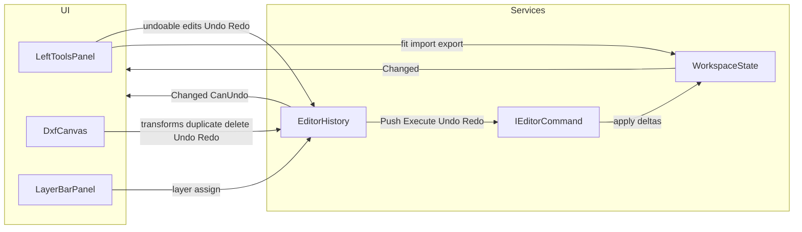
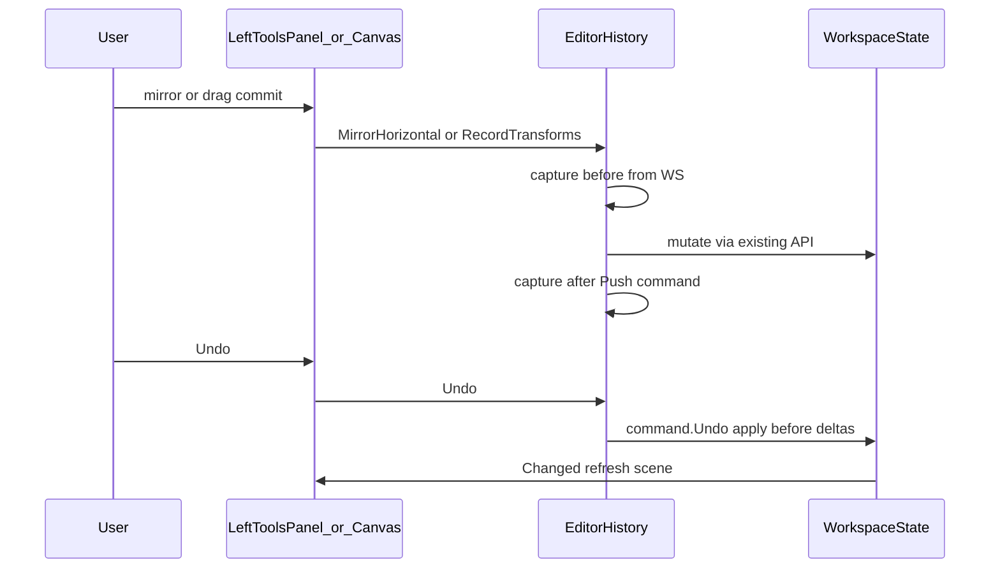

# 001 — Undo / Redo (v1)

**Status:** Implemented  
**Related:** [SRS.md](../SRS.md) feature #20

## Scope (locked)

| Undoable | Not undoable |
|----------|----------------|
| Move, rotate (one gesture each) | Import |
| Mirror H / V | Add layer, selection |
| Duplicate (toolbar or Ctrl/Cmd+D) | Pan / zoom / fit, export |
| Layer assign (block or entity) | |
| Delete (after confirm) | |

- History depth: **50**; new user edit clears redo
- Model: **per-action command deltas** (no full snapshots)
- Toolbar order (top group): Mirror H → Mirror V → Duplicate → Delete → Fit → **Undo → Redo**
- Redo icon: CSS mirror of existing [`BlazorWasmUI/wwwroot/img/undo.svg`](../BlazorWasmUI/wwwroot/img/undo.svg)
- Shortcuts: **Ctrl/Cmd+Z**, **Ctrl/Cmd+Shift+Z** (same `ctrlKey || metaKey` pattern as Duplicate)

## Architecture

History lives in a **separate DI service** so [`WorkspaceState`](../BlazorWasmUI/Services/WorkspaceState.cs) stays document state only (parts, layers, selection, viewport). No undo stacks or command recording inside `WorkspaceState`.

**Name:** `EditorHistory` (scoped, registered next to `WorkspaceState` in [`Program.cs`](../BlazorWasmUI/Program.cs)).

### Responsibilities

| Type | Role |
|------|------|
| [`WorkspaceState`](../BlazorWasmUI/Services/WorkspaceState.cs) | Source of truth for parts/layers/selection/viewport. Keep existing mutate APIs (`ApplyTransforms`, `Mirror*`, `DuplicateSelection`, `AssignSelectionToLayer`, `DeleteSelection`, …). Add only **small helpers** commands need if missing today (e.g. insert part at index for delete/duplicate undo-redo). **No** history fields. |
| **`EditorHistory`** | Owns undo/redo stacks (max 50). Exposes `CanUndo`/`CanRedo`, `Undo()`, `Redo()`, and **recording entry points** for undoable user actions. Raises its own `Changed` (or reuses workspace notify) so toolbar buttons update. |
| **`IEditorCommand`** + concrete commands | Store deltas; `Undo`/`Redo` call into `WorkspaceState` only. |

### New types under `BlazorWasmUI/Services/History/`

- `IEditorCommand` — `void Undo(WorkspaceState ws)` / `void Redo(WorkspaceState ws)`
- `EditorHistory` — stacks + public API (see below); `Push` clears redo; while `Undo`/`Redo` run, do not push again
- **`TransformPartsCommand`** — `{ PartId, Before, After }` poses (`OffsetX/Y`, `RotationDegrees`, `Mirrored`) for move, rotate, mirror
- **`AssignLayersCommand`** — `{ EntityId, BeforeLayerId, AfterLayerId }` (nullable Guids); part-wide or single-entity via `GetLayerAssignmentTargets`
- **`DeletePartsCommand`** — deep-cloned parts (same Guids) + original list indices; Undo reinserts; Redo removes by id
- **`DuplicatePartsCommand`** — deep-cloned **created** parts (same Guids as after duplicate); Undo removes those ids; Redo reinserts the stored clones (identity-stable so redo matches the original duplicate)

### `EditorHistory` public API (UI calls these for undoable work)

| Method | Behavior |
|--------|----------|
| `RecordTransforms(IEnumerable<PartTransformDto> after)` | Snapshot before poses from `WS`, `ApplyTransforms(after)`, push `TransformPartsCommand` if anything changed |
| `MirrorSelectionHorizontal()` / `Vertical()` | Snapshot before → `WS.Mirror*` → snapshot after → push |
| `DuplicateSelection(double? placeAtWorldX = null, double? placeAtWorldY = null)` | Note part ids before → `WS.DuplicateSelection(...)` → deep-clone newly added parts → push `DuplicatePartsCommand` |
| `AssignSelectionToLayer(Guid layerId)` | Snapshot entity layer ids → `WS.AssignSelectionToLayer` → push if changed |
| `DeleteSelection()` | Clone selected parts + indices → `WS.DeleteSelection` → push `DeletePartsCommand` |
| `Undo()` / `Redo()` | Pop/apply command against `WS` |
| `CanUndo` / `CanRedo` | For button disable |

Non-undoable actions (import, fit, export, selection, viewport) keep calling **`WorkspaceState` directly** — no involvement from `EditorHistory`.

### `WorkspaceState` changes (minimal)

- Prefer **not** embedding recording logic.
- Add thin helpers only if commands cannot use today’s APIs cleanly, for example:
  - apply a single part pose / batch poses by id (if `ApplyTransforms` is enough, reuse it)
  - `InsertPartAt(int index, PlacedPart part)` / remove-by-id for delete undo/redo
- Existing mirror/assign/delete/transform methods remain the mutation implementations `EditorHistory` and commands call.

## UI / input

### [`LeftToolsPanel.razor`](../BlazorWasmUI/Components/Editor/LeftToolsPanel.razor)

- Inject `EditorHistory` in addition to `WorkspaceState`
- Mirror / Duplicate / Delete → `EditorHistory`; Fit / Import / Export → `WorkspaceState` (unchanged)
- After Fit: Undo / Redo buttons bound to `EditorHistory.CanUndo` / `CanRedo`; titles include shortcuts
- Redo icon: `tool-icon--mirrored` (`scaleX(-1)`) in [`LeftToolsPanel.razor.css`](../BlazorWasmUI/Components/Editor/LeftToolsPanel.razor.css)

### [`LayerBarPanel`](../BlazorWasmUI/Components/Editor/LayerBarPanel.razor.cs)

- `Assign` → `EditorHistory.AssignSelectionToLayer` instead of `Workspace` directly

### [`dxfCanvas.js`](../BlazorWasmUI/wwwroot/js/dxfCanvas.js) `onKeyDown`

- `mod && z && !shift` → `OnUndoRequested`
- `mod && shift && z` → `OnRedoRequested`
- `preventDefault` when handled

### [`DxfCanvas.razor.cs`](../BlazorWasmUI/Components/Editor/DxfCanvas.razor.cs)

- Inject `EditorHistory`
- `OnPartsTransformed` → `EditorHistory.RecordTransforms`
- `OnDuplicateRequested` → `EditorHistory.DuplicateSelection`
- `OnDeleteRequested` (after confirm) → `EditorHistory.DeleteSelection`
- `OnUndoRequested` / `OnRedoRequested` → `EditorHistory.Undo` / `Redo`

### Help + SRS

- Brief undo/redo bullets in [`InfoHelpModal.razor`](../BlazorWasmUI/Components/Editor/InfoHelpModal.razor)
- Mark feature #20 done when implemented in [`SRS.md`](../SRS.md)

## Implementation notes

- Capture **before** from C# parts inside `EditorHistory` before calling `WS`; JS still commits transforms once on pointer up
- No-op gestures / assigns: no push
- Selection not restored on undo/redo
- Delete confirm stays as today; only confirmed deletes are recorded
- Delete / duplicate clones must preserve part and entity `Id`s and polyline points so redo restores the same identities

## Implementation checklist

- [x] Add `IEditorCommand`, `EditorHistory`, Transform/Assign/Duplicate/Delete commands under `Services/History/`
- [x] Register `EditorHistory` in `Program.cs`; keep `WorkspaceState` free of stacks
- [x] Add only minimal `WorkspaceState` helpers needed by commands (e.g. insert-at-index)
- [x] Route undoable UI paths through `EditorHistory` (toolbar mirror/duplicate/delete, layer bar, canvas transforms/duplicate/delete)
- [x] Add Undo/Redo buttons after Fit; mirrored redo icon CSS
- [x] Wire Ctrl/Cmd+Z and Ctrl/Cmd+Shift+Z in `dxfCanvas.js` + `DxfCanvas` JSInvokable
- [x] Update InfoHelpModal and SRS feature #20

## Out of scope (later)

Import, rename, add-layer, selection, viewport history
